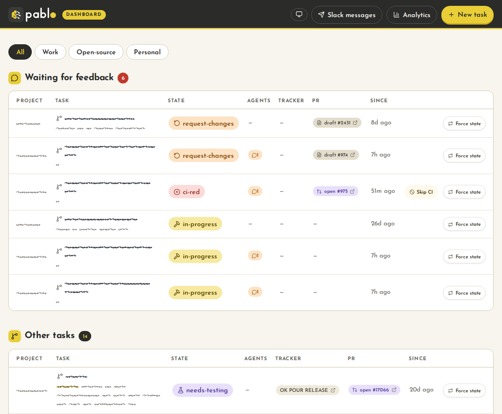

<p align="center">
  <picture>
    <source media="(prefers-color-scheme: dark)" srcset="site/assets/logo-light.svg">
    
  </picture>
</p>

<p align="center"><i>Personal Assistant for Boring Logic &amp; Operations</i></p>

<p align="center">
  PABLO watches your pull requests and launches the right AI agent, in the right worktree, when something needs doing.
</p>

<p align="center">
  <a href="https://getpablo.dev/"><b>Website</b></a> ·
  <a href="https://getpablo.dev/docs/"><b>Documentation</b></a> ·
  <a href="https://getpablo.dev/docs/quickstart/"><b>Quickstart</b></a>
</p>

<p align="center">
  
</p>

## Quickstart

```bash
curl -fsSL https://getpablo.dev/installer | bash   # interactive: pablo on your PATH, scheduler + dashboard running

cd ~/path/to/your/repository
pablo project:new                  # a short wizard
pablo task:start <issue-url>       # branch + worktree + an agent writing the plan
```

Then watch your tasks on http://127.0.0.1:8321 or with `pablo task:list`.

**You need:**

- Linux or macOS;
- git and [`gh`](https://cli.github.com/), logged in;
- a runtime, the agent CLI: [OpenCode](https://opencode.ai), [Claude Code](https://www.anthropic.com/claude-code) or [GitHub Copilot CLI](https://github.com/features/copilot/cli);
- an agent environment (ADE), where agents run: [Orca](https://www.onorca.dev/) (default) or [OpenChamber](https://openchamber.dev/) (OpenCode only), or none (headless: agents run in the background).

PABLO itself is a single binary: no PHP needed.
Using Jira or Linear, or want the details? Read the [Quickstart](https://getpablo.dev/docs/quickstart/) and the [installation guide](https://getpablo.dev/docs/installation/).

## What PABLO never does

Agents propose; you decide. PABLO writes no code of its own: only the rebase conflict resolver agent edits files, to replay your branch. It never touches your issue tracker (GitHub Issues, Jira, Linear stay read-only), never merges or closes a pull request, and never comments or reviews. It never writes a commit of its own: commits happen only when you run `/pablo-commit-and-pr`, which also pushes. It pushes otherwise only with sync's `sync.auto_apply` (off by default), which rebases (or merges, per `sync.strategy`) a clean worktree onto its base branch and pushes with `--force-with-lease`, never plain `--force`, and when the conflict resolver pushes its replay of such a rebase the same way. The full list: [What PABLO may change](https://getpablo.dev/docs/safety/).

## Learn more

- [Documentation](https://getpablo.dev/docs/): configuration, states, agents, dashboard, troubleshooting;
- [Contributing](https://getpablo.dev/docs/development/): run it from a checkout, tests and QA;
- [Licence](LICENSE).
